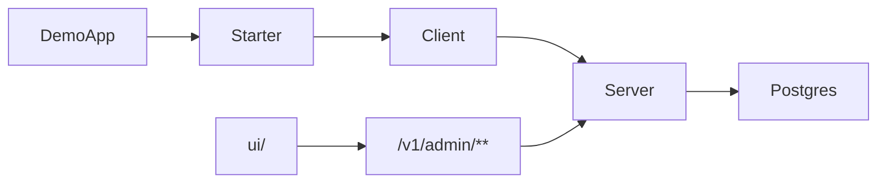

# Architecture

Monorepo layout:

```
idemgate/
  server/                 # HTTP API + PostgreSQL registry
  idemgate-client/                 # Java SDK
  idemgate-spring-boot-starter/    # @Idempotent integration
  samples/demo-app/       # example consumer
  ui/                     # Next.js dashboard (Vercel Root Directory = ui)
  docs/
```



Server is the source of truth for claim/complete/lease. The starter encodes the claim → work → complete loop and fail-closed defaults. The dashboard reads `/v1/admin/**` (body redacted by default).
